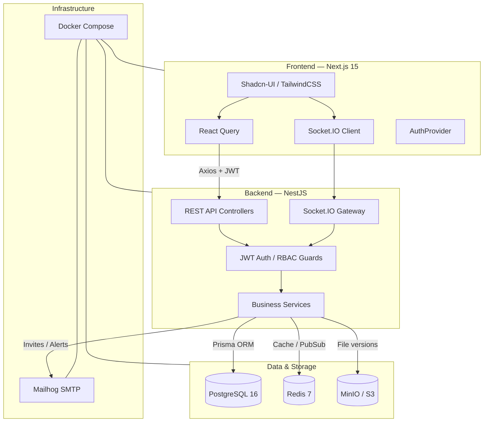

# Team Project Hub


A real-time team collaboration platform for project planning, task tracking, work-hour logging, and analytics reporting. Built with a Next.js 15 + Tailwind/Shadcn-UI frontend, a NestJS + Prisma backend, PostgreSQL, Redis, MinIO (S3-compatible object storage), and Socket.IO for live updates.

---

## Architecture



---

## Tech Stack

| Layer       | Technology                                       |
|-------------|--------------------------------------------------|
| Frontend    | Next.js 15 (App Router), React 19, TypeScript    |
| Styling     | TailwindCSS, Shadcn-UI, Radix UI primitives      |
| Charts      | Recharts                                         |
| Data fetch  | @tanstack/react-query, Axios                     |
| Real-time   | Socket.IO client                                 |
| Forms       | react-hook-form, zod                             |
| State       | React Context, Zustand                           |
| Backend     | NestJS, Prisma ORM, PostgreSQL                   |
| Cache       | Redis                                            |
| Storage     | MinIO (S3-compatible)                            |
| Email       | Nodemailer + Mailhog (dev)                       |
| DevOps      | Docker, Docker Compose                           |

---

## Features

- **Project Management** — create projects, assign teams, view status on a Kanban board (TODO / IN PROGRESS / DONE).
- **Task Tracking** — tasks with status, priority, assignee, due date, threaded comments, and file versioning.
- **Work Hour Logging** — log hours against tasks with an admin approval/rejection workflow.
- **Reports & Analytics** — Recharts bar chart for project work-hour distribution and pie chart for member workload, with CSV export.
- **Team & RBAC** — 5 role tiers (Admin, Project Manager, Developer, QA, Viewer) with fine-grained permissions.
- **Real-time** — Socket.IO broadcasts task updates, work-log reviews, and notifications.
- **Notifications** — in-app notification feed with mark-as-read and unread badge.
- **Authentication** — JWT-based login/register with protected routes.
- **File Management** — per-task file uploads with version history stored in MinIO.

---

## RBAC Roles & Permissions

| Role              | Projects | Tasks         | Work Logs              | Reports | Team Mgmt |
|-------------------|----------|---------------|------------------------|---------|-----------|
| **Admin**         | CRUD all | CRUD all      | Log + approve/reject   | View    | Invite / remove / assign roles |
| **Project Manager** | Create & manage own | Assign, update | Log + approve/reject   | View    | Invite members |
| **Developer**     | View     | Update assigned | Log own hours          | View    | —         |
| **QA**            | View     | Update assigned, comment | Log own hours   | View    | —         |
| **Viewer**        | View (read-only) | View (read-only) | —                | View    | —         |

---

## Prisma Schema Overview

```prisma
model User {
  id           String     @id @default(uuid())
  email        String     @unique
  name         String
  passwordHash String
  avatarUrl    String?
  role         Role       @default(VIEWER)
  isActive     Boolean    @default(true)
  teamMembers  TeamMember[]
  projects     ProjectMember[]
  tasks        Task[]     @relation("assignee")
  reportedTasks Task[]    @relation("reporter")
  workLogs     WorkLog[]
  comments     Comment[]
  notifications Notification[]
  createdAt    DateTime   @default(now())
  updatedAt    DateTime   @updatedAt
}

model Team {
  id          String       @id @default(uuid())
  name        String
  description String?
  members     TeamMember[]
  projects    Project[]
  createdAt   DateTime     @default(now())
  updatedAt   DateTime     @updatedAt
}

model TeamMember {
  id      String @id @default(uuid())
  teamId  String
  userId  String
  role    Role   @default(VIEWER)
  team    Team   @relation(fields: [teamId], references: [id])
  user    User   @relation(fields: [userId], references: [id])
  @@unique([teamId, userId])
}

model Project {
  id          String          @id @default(uuid())
  name        String
  description String?
  status      TaskStatus      @default(TODO)
  teamId      String
  team        Team            @relation(fields: [teamId], references: [id])
  createdById String
  createdBy   User            @relation(fields: [createdById], references: [id])
  tasks       Task[]
  members     ProjectMember[]
  createdAt   DateTime        @default(now())
  updatedAt   DateTime        @updatedAt
}

model ProjectMember {
  id        String  @id @default(uuid())
  projectId String
  userId    String
  role      Role    @default(VIEWER)
  project   Project @relation(fields: [projectId], references: [id])
  user      User    @relation(fields: [userId], references: [id])
  @@unique([projectId, userId])
}

model Task {
  id          String       @id @default(uuid())
  title       String
  description String?
  status      TaskStatus   @default(TODO)
  priority    Priority     @default(MEDIUM)
  dueDate     DateTime?
  projectId   String
  project     Project      @relation(fields: [projectId], references: [id])
  assigneeId  String?
  assignee    User?        @relation("assignee", fields: [assigneeId], references: [id])
  reporterId  String
  reporter    User         @relation("reporter", fields: [reporterId], references: [id])
  comments    Comment[]
  fileVersions FileVersion[]
  workLogs    WorkLog[]
  createdAt   DateTime     @default(now())
  updatedAt   DateTime     @updatedAt
}

model WorkLog {
  id           String        @id @default(uuid())
  userId       String
  user         User          @relation(fields: [userId], references: [id])
  taskId       String
  task         Task          @relation(fields: [taskId], references: [id])
  projectId    String
  project      Project       @relation(fields: [projectId], references: [id])
  date         DateTime
  hours        Float
  description  String
  status       WorkLogStatus @default(PENDING)
  reviewedById String?
  reviewedBy   User?         @relation(fields: [reviewedById], references: [id])
  createdAt    DateTime      @default(now())
  updatedAt    DateTime      @updatedAt
}

model FileVersion {
  id         String   @id @default(uuid())
  taskId     String
  task       Task     @relation(fields: [taskId], references: [id])
  uploaderId String
  uploader   User     @relation(fields: [uploaderId], references: [id])
  fileName   String
  fileUrl    String
  fileSize   Int
  mimeType   String
  version    Int
  createdAt  DateTime @default(now())
}

model Comment {
  id        String   @id @default(uuid())
  taskId    String
  task      Task     @relation(fields: [taskId], references: [id])
  authorId  String
  author    User     @relation(fields: [authorId], references: [id])
  content   String
  createdAt DateTime @default(now())
  updatedAt DateTime @updatedAt
}

model Notification {
  id        String           @id @default(uuid())
  userId    String
  user      User             @relation(fields: [userId], references: [id])
  type      NotificationType
  title     String
  message   String
  isRead    Boolean          @default(false)
  link      String?
  createdAt DateTime         @default(now())
}

enum Role { ADMIN PROJECT_MANAGER DEVELOPER QA VIEWER }
enum TaskStatus { TODO IN_PROGRESS BLOCKED DONE }
enum Priority { LOW MEDIUM HIGH URGENT }
enum WorkLogStatus { PENDING APPROVED REJECTED }
enum NotificationType { TASK_ASSIGNED TASK_UPDATED WORK_LOG_SUBMITTED WORK_LOG_REVIEWED PROJECT_CREATED COMMENT INVITE }
```

---

## API Endpoints

### Auth
| Method | Endpoint           | Description              |
|--------|--------------------|--------------------------|
| POST   | `/auth/register`   | Register a new user      |
| POST   | `/auth/login`      | Login, returns JWT       |
| GET    | `/auth/me`         | Get current user profile |
| POST   | `/auth/logout`     | Logout (blacklist token) |

### Teams
| Method | Endpoint                        | Description               |
|--------|---------------------------------|---------------------------|
| GET    | `/teams`                        | List teams                |
| POST   | `/teams`                        | Create team               |
| GET    | `/teams/:id/members`            | List team members         |
| POST   | `/teams/:id/members`            | Invite member             |
| PATCH  | `/teams/:id/members/:memberId`  | Update member role        |
| DELETE | `/teams/:id/members/:memberId`  | Remove member             |

### Projects
| Method | Endpoint                        | Description               |
|--------|---------------------------------|---------------------------|
| GET    | `/projects`                     | List projects             |
| POST   | `/projects`                     | Create project            |
| GET    | `/projects/:id`                 | Get project detail        |
| PATCH  | `/projects/:id`                 | Update project            |
| DELETE | `/projects/:id`                 | Delete project            |
| GET    | `/projects/:id/stats`           | Project task/hour stats   |
| GET    | `/projects/:id/members`         | List project members      |
| POST   | `/projects/:id/members`         | Add project member        |

### Tasks
| Method | Endpoint                        | Description               |
|--------|---------------------------------|---------------------------|
| GET    | `/tasks`                        | List tasks (filters)      |
| POST   | `/tasks`                        | Create task               |
| GET    | `/tasks/:id`                    | Get task                  |
| PATCH  | `/tasks/:id`                    | Update task               |
| DELETE | `/tasks/:id`                    | Delete task               |
| GET    | `/tasks/:id/comments`           | List comments             |
| POST   | `/tasks/:id/comments`           | Add comment               |
| GET    | `/tasks/:id/files`              | List file versions        |
| POST   | `/tasks/:id/files`              | Upload file (new version) |

### Work Logs
| Method | Endpoint                        | Description               |
|--------|---------------------------------|---------------------------|
| GET    | `/work-logs`                    | List work logs            |
| POST   | `/work-logs`                    | Create work log           |
| PATCH  | `/work-logs/:id`                | Update work log           |
| DELETE | `/work-logs/:id`                | Delete work log           |
| PATCH  | `/work-logs/:id/review`         | Approve / reject          |

### Notifications
| Method | Endpoint                        | Description               |
|--------|---------------------------------|---------------------------|
| GET    | `/notifications`                | List notifications        |
| PATCH  | `/notifications/:id/read`       | Mark as read              |
| POST   | `/notifications/read-all`       | Mark all as read          |
| GET    | `/notifications/unread-count`   | Unread count              |

### Reports
| Method | Endpoint                        | Description               |
|--------|---------------------------------|---------------------------|
| GET    | `/reports/project-hours`        | Hours per project         |
| GET    | `/reports/member-workload`      | Hours per member          |

---

## Local Setup

### Option 1 — Docker Compose (recommended)

```bash
# 1. Clone the repo
git clone <repo-url>
cd team-project-hub

# 2. Copy environment files
cp frontend/.env.example frontend/.env.local

# 3. Start all services (postgres, redis, minio, mailhog, backend, frontend)
docker-compose up -d --build

# 4. Run database migrations (inside the backend container)
docker-compose exec backend npx prisma migrate deploy

# 5. Open the app
# Frontend:  http://localhost:3000
# Backend:   http://localhost:4000/api
# Mailhog:   http://localhost:8025
# MinIO:     http://localhost:9001
```

### Option 2 — Manual Setup

**Backend**

```bash
cd backend
npm install
cp .env.example .env
# set DATABASE_URL, REDIS_URL, JWT_SECRET, MINIO_*
npx prisma migrate dev
npm run start:dev
```

**Frontend**

```bash
cd frontend
npm install
cp .env.example .env.local
npm run dev
```

---

## Environment Variables

| Variable                    | Default                          | Description                          |
|-----------------------------|----------------------------------|--------------------------------------|
| `POSTGRES_USER`             | `tph`                            | PostgreSQL username                  |
| `POSTGRES_PASSWORD`         | `tph_secret`                     | PostgreSQL password                  |
| `POSTGRES_DB`               | `team_project_hub`               | PostgreSQL database name             |
| `DATABASE_URL`              | —                                | Prisma connection string             |
| `REDIS_URL`                 | `redis://redis:6379`             | Redis connection URL                 |
| `JWT_SECRET`                | —                                | Secret used to sign JWTs             |
| `JWT_EXPIRES_IN`            | `7d`                             | JWT expiration                       |
| `MINIO_ROOT_USER`           | `minioadmin`                     | MinIO access key                     |
| `MINIO_ROOT_PASSWORD`       | `minioadmin`                     | MinIO secret key                     |
| `MINIO_BUCKET`              | `team-project-hub`               | S3 bucket for file uploads           |
| `SMTP_HOST` / `SMTP_PORT`   | `mailhog` / `1025`               | SMTP server (Mailhog in dev)         |
| `NEXT_PUBLIC_API_URL`       | `http://localhost:4000/api`      | Backend API base URL (frontend)      |
| `NEXT_PUBLIC_SOCKET_URL`    | `http://localhost:4000`          | Socket.IO server URL (frontend)      |

---

## Project Structure

```
team-project-hub/
├── frontend/
│   ├── src/
│   │   ├── app/
│   │   │   ├── (dashboard)/
│   │   │   │   ├── layout.tsx              # Sidebar + topbar shell
│   │   │   │   ├── projects/page.tsx       # Kanban board + create modal
│   │   │   │   ├── projects/[id]/page.tsx  # Project detail + task board
│   │   │   │   ├── tasks/page.tsx          # Tasks with filters & detail modal
│   │   │   │   ├── work-logs/page.tsx      # Hour logging + approval
│   │   │   │   ├── reports/page.tsx        # Recharts analytics
│   │   │   │   ├── team/page.tsx           # Members + role assignment
│   │   │   │   └── notifications/page.tsx  # Notification feed
│   │   │   ├── layout.tsx                  # Root layout + Providers
│   │   │   ├── page.tsx                    # Landing / login page
│   │   │   └── globals.css                 # Tailwind + CSS variables
│   │   ├── components/
│   │   │   ├── ui/                         # Shadcn-style components
│   │   │   ├── providers.tsx               # React Query + Auth + Socket
│   │   │   ├── socket-provider.tsx
│   │   │   └── protected-route.tsx
│   │   ├── lib/
│   │   │   ├── api-client.ts               # Axios instance + all API methods
│   │   │   ├── auth.tsx                    # Auth context (login/register/logout)
│   │   │   ├── socket.ts                   # Socket.IO singleton
│   │   │   ├── types.ts                    # Domain TypeScript interfaces
│   │   │   └── utils.ts                    # cn() helper
│   │   └── types/index.ts
│   ├── Dockerfile
│   ├── tailwind.config.ts
│   ├── postcss.config.js
│   ├── tsconfig.json
│   └── package.json
├── backend/
│   └── Dockerfile
├── docker-compose.yml
├── .gitignore
└── README.md
```

---

## Deployment Guide

### Frontend — Vercel

1. Push the repo to GitHub.
2. Import the `frontend` directory as a Vercel project.
3. Set environment variables:
   - `NEXT_PUBLIC_API_URL` → your backend URL
   - `NEXT_PUBLIC_SOCKET_URL` → your backend URL
4. Deploy. Vercel auto-detects Next.js.

### Backend — Railway

1. Create a new Railway project from the `backend` directory.
2. Add PostgreSQL and Redis plugins (Railway provides connection strings).
3. Set env vars: `DATABASE_URL`, `REDIS_URL`, `JWT_SECRET`, `MINIO_*`, `CORS_ORIGIN`.
4. Railway runs `npm run build` then `npm run start` automatically.

### Database — Supabase

1. Create a Supabase project.
2. Copy the connection string into `DATABASE_URL` (set `?pgbouncer=true` for pooled connections).
3. Run `npx prisma migrate deploy` against the Supabase DB.

### Object Storage — MinIO (self-hosted) or AWS S3

- **MinIO**: included in `docker-compose.yml`; access the console at `http://localhost:9001` and create the `team-project-hub` bucket.
- **AWS S3**: set `MINIO_ENDPOINT=s3.amazonaws.com`, `MINIO_USE_SSL=true`, and provide AWS access keys.

---

## Key Engineering Decisions

1. **Next.js 15 App Router + React 19** — server-first rendering, streaming, and the latest React features for a modern, resume-worthy stack.
2. **Shadcn-UI pattern** — copy-paste components built on Radix primitives for full control over styling and accessibility, without a heavy component-library dependency.
3. **React Query for server state** — declarative data fetching with caching, refetching, and mutation invalidation; keeps client state minimal.
4. **Socket.IO for real-time** — chosen over raw WebSockets for built-in reconnection, rooms, and fallback to long-polling.
5. **Prisma ORM** — type-safe database access with migrations, reducing boilerplate and runtime errors.
6. **MinIO for object storage** — S3-compatible and runs locally in Docker, so the file-versioning feature works offline and can swap to AWS S3 in production.
7. **Role-based access control at the API layer** — NestJS guards enforce permissions server-side; the frontend only hides UI affordances (never a security boundary).
8. **JWT in localStorage** — simplicity for a portfolio project; a production deployment would use httpOnly cookies + refresh tokens.
9. **Docker Compose for one-command setup** — orchestrates Postgres, Redis, MinIO, Mailhog, backend, and frontend so reviewers can spin up the full stack instantly.

---

## Resume Project Description

> **Team Project Hub** — A full-stack real-time team collaboration platform that lets organizations plan projects, track tasks on Kanban boards, log billable work hours with an admin approval workflow, and generate analytics reports. Built with a Next.js 15 + TypeScript + Tailwind/Shadcn-UI frontend (Recharts for dashboards, React Query for data fetching, Socket.IO for live updates) and a NestJS + Prisma + PostgreSQL backend, with Redis caching, MinIO (S3) file storage with versioning, and JWT-based RBAC across 5 roles. Containerized with Docker Compose for one-command local deployment. Implements end-to-end features including project Kanban boards, task comments and file versioning, work-log approval queues, CSV-exportable reports, and a real-time notification system.

---

## License

MIT
